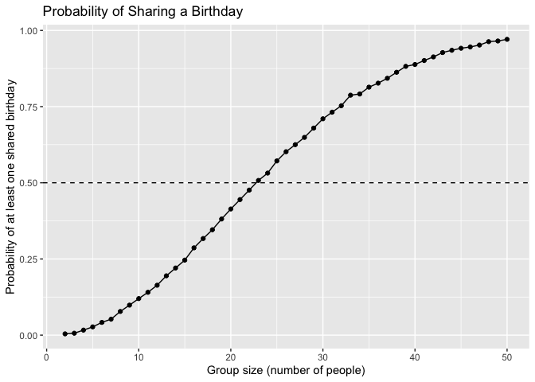

p8105_hw5_ejc2222
================
2026-11-18

# Problem 1

## The Birthday Problem

``` r
birthday_repeat = function(n_room) {
  
  birthdays = sample(1:365, size = n_room, replace = TRUE)
  
  repeated_birthdays = length(unique(birthdays)) < n_room
  
  return(repeated_birthdays)
  
}
```

``` r
set.seed(1236)

birthday_results_df =
  expand_grid(
    number_of_people = 2:50,
    iter = 1:10000
  ) |>
  mutate(
    repeated = map_lgl(number_of_people, birthday_repeat)
  )
```

``` r
birthday_prob_df = birthday_results_df |>
  group_by(number_of_people) |>
  summarize(prob_of_repeat = mean(repeated))

birthday_prob_df |>
  ggplot(aes(x = number_of_people, y = prob_of_repeat)) +
  geom_point() +
  geom_line() +
  geom_hline(linetype = "dashed", yintercept = 0.5) +
  labs(
    title = "Probability of Sharing a Birthday",
    x = "Group size (number of people)",
    y = "Probability of at least one shared birthday"
  )
```

<!-- -->

The probability of a shared birthday rises quickly with group size. It
starts near zero for very small groups, climbs steeply between roughly
15 and 35 people, and then levels off as it approaches 1. The
probability first exceeds 0.50 at a group size of 23, so a shared
birthday is more likely than not in a group of only about two dozen
people. By 50 people, the probability reaches 0.97, making a shared
birthday highly likely. Each new person can share a birthday with anyone
already in the group, so the number of possible pairs grows much faster
than the group size.
